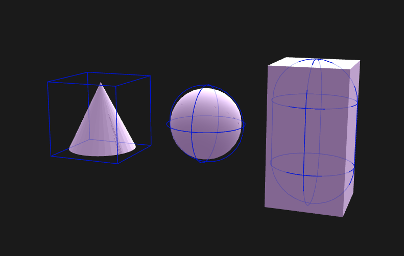

This week I'm working on the collision system, probably the last critical module that my engine and game needed. Drawing and moving is solved, but how they interact with each other is what shifted the 3D software to a real game world builder. 

I'll be splitting this topic into two parts, preparing the structure then finally the collision math. 

## Colider World Structure

Textbooks may guide us in theoretical part of game engines, but structure is a circumstance - specifics with no right answers. I'll give you what mine looks like. 

First you want to treat a collider as properties owned by objects. I've placed it under SceneObject properties, a parent of all scene-able objects. This collider will be inherited by spatials, cameras, and lights.

```
   // collision.h

    struct Collider {
        bool active = false;
        // ...
        ObjectFactory::SceneObject * owner = nullptr; // link to the collider owner
        ColliderShape shape = ColliderShape::BOX;
        Geometry::AABB box = {};                     // Simple min-max bound no OBB
        Geometry::Capsule capsule = {};              // One point and radius
        Geometry::Sphere sphere = {};                // Two points and radius
        ColliderMesh GetVisualMesh();                // for drawing data

        // ...
    }
    
    // objectfactory.h
    struct SceneObject : Node {
        // ...
        Collision::Collider collider = {};
        SceneObject(ObjectType t) : Node(t) { collider.owner = this; };
        // ...
    }

```

Then, just like physics engine, collision system also requries separate world to contain these colliders. Registered every frame, doing it while traversing the scene graph is ideal. That said, In most simple cases you won't need collision world like this; for example in 2D games with (except physics heavy one) simple geometry check like A.intersect(B) should suffice, please decides the tradeoff on your own project circumstances.

```
    // collision.h

    struct CollisionWorld {
        std::vector<Collider*> colliders;
        // ...
    };

```

## Drawing The Collider

Rather than drawing full real mesh, collider's appearance can be simplified. For example the cube is just borrowing AABB pattern, sphere is just three circles drawn in all axis, and then capsule are just bunch of circles, half circles and connectors drawn together. This is what *Unity* and *Godot* ultimately do as well.



You just need these two to makes sense of the rest. 

```
// Highschool trig `x = r cos(∝)` and `y = r sin(∝)` -> expand to 3D axis with Z

// Full Circle
for(uint16_t i = 0; i < segments; ++i) {
    float angle = two_pi * ((float) i / segments);
    mesh.vertices.push_back(Vec4{
         std::cosf(angle) * radius,
         0.0f,
         std::sinf(angle) * radius,
         1.0f
    } + center); // interchange as needed for different axis
    // indices : 01 12 23 34
    mesh.indices.push_back(index_offset + i);
    mesh.indices.push_back(index_offset + ((i+1) % segments));
}

// Half Circle
for(uint16_t i = 0; i <= half_segments; ++i) {
    float angle = two_pi * ((float) i / segments);
    mesh.vertices.push_back(Vec4{
         std::cosf(angle) * radius,
         std::sinf(angle) * radius,
         0.0f,
         1.0f
    } + center0);
    if(i < half_segments) {
         mesh.indices.push_back(index_offset + i);
         mesh.indices.push_back(index_offset + i + 1);
    }
}

```

If you like to follow the style I'm using to draw these colliders (faded back), I'm drawing it twice with different depth-stencil profile. First draw normally where the the `LESS` then Second draw with the opposite effect `GREATER`. The Former draws only if the pixel is closer and the later if it's further.

```
this->box_drawable->topology = Graphics::Topology::LINE;

// front
Vec4 color = Math::RGBAToVec4(0, 21, 214, 255);
this->box_drawable->material->SetParam(Graphics::ShaderStage::PS , "color", &color);
this->box_drawable->depthstencil = DepthStencilOptions::DEFAULT;
Drawing::RenderDrawable(this->box_drawable);

// back
color.w = 0.25f;
this->box_drawable->material->SetParam(Graphics::ShaderStage::PS , "color", &color);
this->box_drawable->depthstencil = DepthStencilOptions::OCCLUDED;
Drawing::RenderDrawable(this->box_drawable);

```

## What's Next

The final part is about making these pretty shapes actually collides and affecting the real object transformation. There will be bunch of Intersections math, phasing and *Collision Callbacks*. see you later.

## Reference

Jason Gregory, *Game Engine Architecture*, 3rd ed, p. 853.

