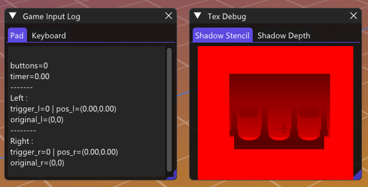
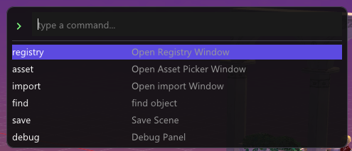
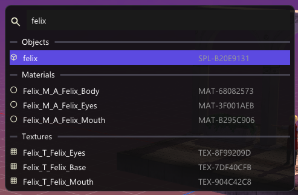

I've migrated the gamepad debug and few shadow textures from using *imgui overdraw* to a much proper panel-ed layout.
High chance that we'll need to log even more information there so it's made to scale in mind with tabbed structure

## Command Palette

This is one of the reason why I did my status line the way did, inspired from vim and zed
I now have two modes of quick access, 
 - status cmd line 
  
 - using `ctrl+p` to spawn a list of cmd 
  

## Global Search

I believe in the future searching object can be tough. What's better than having a [telescope](https://github.com/nvim-telescope/telescope.nvim) like helper ? 

