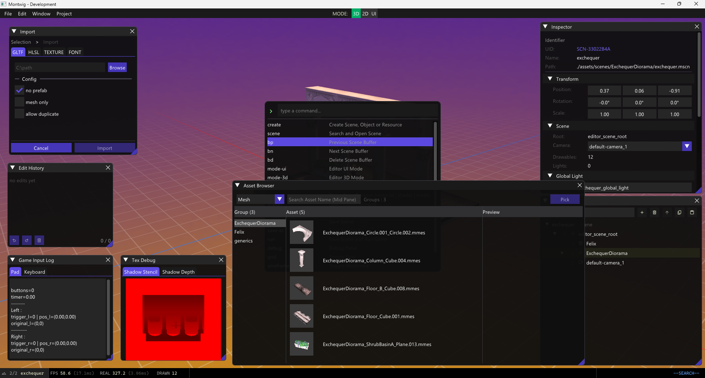

I'm here to record what I found during my experiment with LLMs over the past week. **In short, I found it very useful, almost liberating.** It's the feeling that you can finally make progress on things that used to make you tremble when you woke up, knowing you'd spend the day tweaking resource management bugs.

As I wrote before, in this test I tried to avoid writing any implementation code, except for structural components of the engine like header files and empty functions. The plan is to reduce my involvement in algorithmic work and focus more on the systemic side of the software, while still preserving the aesthetic and patterns I've built over the years.

## Gain

Allow me to be imprecise here, and think in orders of magnitude. If you let it run wild with a more aggressive agentic workflow, you could probably get 10 times more. The productivity gain is like going from 7 man-days down to 7 minutes. However, I keep things slow and precise. I review every piece of code it proposes, for the sake of control. That's the best approach I can tolerate. Architecture and code structure are now my priority. Imagine this: the tool is paid, and the moment you can't pay for whatever reason, it won't be funny for the project to stop because you ran out of tokens!

I asked the AI to dig into my repo and compare them: 18 days' worth of `master-llm` against my own history. My eighteen days of `master-llm` is now more than what I wrote by myself in the past five months. Most of it is ImGui's verbosity, but plenty of it is also difficult refactoring that is low in LOC but logically dense.

That said, I'm a little weirded out that I still feel I have 90+% comprehension of the codebase. Among those 40K LOC, I can probably point out which part is responsible for what. It feels like I've found some balance in this workflow. It's definitely not vibe coded, but it's not artisanally typed either.

## Lost

> *"A cynic is a man who knows the price of everything, and the value of nothing."*
>
> *"And a sentimentalist, my dear Darlington, is a man who sees an absurd value in everything, and doesn't know the market price of any single thing."*
>
> — **Oscar Wilde**, *Lady Windermere's Fan*

The AI debate is split between extreme Pro and Anti-AI camps that keep pointing at each other on social media. We, however, are concerned with the goal and the tradeoffs, not the hype.

I gained time, but the goalposts moved further away. The time lost comes from expectations: once people know what you can do now, they expect more. As famously written:

> "To put it quite bluntly: as long as there were no machines, programming was no problem at all; when we had a few weak computers, programming became a mild problem, and now we have gigantic computers, programming has become an equally gigantic problem. In this sense the electronic industry has not solved a single problem, it has only created them, it has created the problem of using its products."
>
> — **Edsger Dijkstra**, *The Humble Programmer*

You may gain convenience, but you lose the struggle. The nights spent scrolling through Stack Overflow or watching Traversy Media videos are the grit you build during your apprentice years. That struggle did wonders for the brain. It responds to struggle and adapts, and it builds mental fortitude.

That said, we also have to admit that life is larger than we think, and there's never a shortage of things to do. One cannot keep writing assembly forever, otherwise no spaceship would ever land on the moon and no car would drive itself. The mental burden is just too big. So yes, it's an inevitable loss for the sake of the future, and the same applies to this technology.

## You Eat More Than You Can Chew

On the negative side of frontier LLMs, the amount of code they generate and the density of the solutions they pack are addictive. A big module you never hoped to finish during your night shift is now just a prompt away. I found myself consuming and reviewing code like never before, and it flooded my day. If anything, the obstacle to completing the work is now me, the human. That's deliberate, and I plan to become even more of that obstacle. That's what I call benefiting from AI to enrich oneself: learn what we're weak at, and use their excess brainpower to show us the tricks that are mostly hidden in books, libraries, universities and studios.

## Rabbit Holing

One thing I noticed during this experiment is that my workflow might have hindered the LLM itself. My taste might not be what the LLM considers effective. After years of heavy solo coding, it's hard to trust any entity other than yourself, even when they can arguably write better C++ now, with strong edge case handling, and remember many components that you forget.

So it's better to stop overthinking every line. Read the intention of the function instead, steer when necessary, and ignore the noise. For example, you don't have to sweat over `n < size-1 && n > 0`. You can see it's clamping a value or protecting a loop's bound.

Reviewing still takes mental energy, and it's even harder when you didn't write the code yourself. Beyond the functional block level, I don't think it's worth the attention. Some people prefer `i++` and some prefer `++i`. At this point it's just a preference, so let the LLM decide. *Premature optimization is the root of all evil.*

## What's Next

It's hard to ignore the benefits of agentic coding. As long as you review every piece of code produced and keep it under scrutiny, the downsides of delegating can be mitigated to a reasonable degree. So yes, I'll keep relying on this going forward, with care.

Should I merge it to `master`?