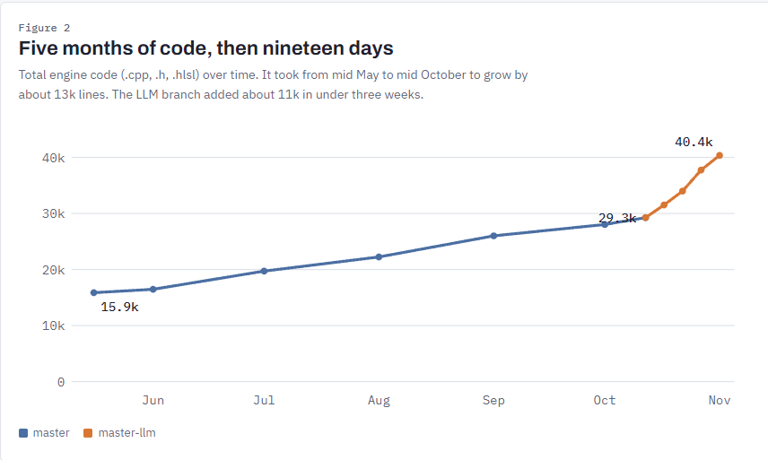

I'm here to record of what I've found during  my experiment with LLM for the past week. **In short I found it very useful, almost liberating**. It's the feeling of finally you can have progress on the things that once makes you tremble to wake up and knowing that day you'll just tweaking some resource management bugs.  

As I wrote before, this test is where I tried avoid to write any implementation codes, except for structural components of the engine like header files, and empty functions. The plan is to reduce the ratio of my involvement in algorithmic work to a more systemic part of the software while still preserving the code's aesthetic and pattern I've built over years.   

## Gain

Allow me to be unprecise at this point, and It's in order of magnitude. Perhaps if you let it run wild with much aggresive agentic workflow, you can get 10 times of magnitude. The productivity gain is like comparing the used to be 7 MD, down to 7 minutes. However, I keep things slow and precise. I review every code proposed for the sake of control. For me that's the best approach that I can tolerated. I found architectural, and code structure is pretty much my priority now. Imagine: The tool is paid, the moment you can't pay anymore for whatever reason, it won't be funny for the project to stop because you run out of tokens !   

I asked AI to dig to my repo and compare them, 18 days worth of master-llm.  
So now my eighteen days of `master-llm` is even more than what i wrote by my own in the past five. Although most of them are ImGui verbosity, I still testify that plenty of those are difficult refactors to with fewer LOC but logically dense. Still the amount of code written is astronomical, even with manual mode. 

That said I kind of weirded out that It's felt like I still have 90+% comprehension of the code base. Among those 40K LOC, I can probably point out which part is responsible for what. Feels I've discovered some sort of balance in this workflow.

## Lost

> *"A cynic is a man who knows the price of everything, and the value of nothing"*  
> "And a sentimentalist, my dear Darlington, is a man who sees an absurd value in everything, and doesn’t know the market price of any single thing."  
> ***-***  Lady Windermere’s Fan, **Oscar Wilde**

AI faction, between the Pro and the Anti-AI is of the extreme spectrum that kept pointing at each other on social media. We however are concerns with the goal, and tradeoffs rather than hype.

I gained time, but the goal post is getting futher. The time lost came from the expectation that will come after the fact they know what you can do now. As famously written: 

> "To put it quite bluntly: as long as there were no machines, programming was no problem at all; when we had  a few weak computers, programming became a mild problem, and now we have gigantic computers, programming has become an equally gigantic problem. In this sense the electronic industry has not solved a single problem, it has only created them, it has created the problem of using its products.  
>
> - The Humble Programmer, ++**Edsger Dijkstra**++

You may gain convenience, but lose the struggle. The night where you scrolling over stack overflow, or watching traversy video on coding is a grit that you develop during apprentice years. That struggle did wonders to the brain, and it responds to the struggle and adapt - it creates mental fortitude.

That said, we also have to admit, that the life is larger than we think and have never run out of agenda on what to do. One cannot stay writing assembly code forever, otherwise no spaceship can ever land on moon, or no cars can drive itself. The mental burden is just too big. So yes it's the inevitable lost for the sake of future. This applies to what we're doing with this technology as well.

## You Eat More than you can Chew

On the negative outlook of frontier LLM, the amount of code it generates and the density of solution it packs, is really something that gives yout this feeling of addiction. One big modules you never hope to finish during your night shift, now i just a prompt away. I found myself eating and reviewing code like never before, it flooded my day. If any, the obstacle toward the completion of the work here is actually me the human! that's deliberate and I'm planning to become more of that obstacle to them. That's what I called benefitting from AI to enrich oneself. Learn things what we're weak at and use their excess brain power to show us the trick that mostly hidden in books, libraries, universities and studios.

## Rabbit Holing

One self observation i came across while doing this experiment, is that I came to realize that My workflow might have hindered the LLM itself. My taste might not be what LLM considered effective. It's a habit of heavy years of coding by your own, that it's kinda hard to give trust to some other entity other than yourself. Even when they're arguably can write better C++ code now, with strong edge case handling and somehow remembers many components that yourself forget. So It's better to stop overthink every line, and instead read the intention of the function - steer when necessary, ignore the noise. For example, you dont have to sweat over `n < size-1 && n > 0` you know the it's trying to clamp values or protect loop's bound.  

Reviewing still takes mental energy, and it's even harder when you didn't write it yourself. Beyond functional block level, I just think it doesn't worth the attention. Some people prefer `i++` or `++i` at this point it's a preference, and let LLM decides. *Premature optimizations is the root of evil.*

## What's Next

It's hard to ignore the benefit on adopting agentic coding, as long as you review every code produced and keep it under scrutiny, the downsides of delegating can be mitigated within reasonable degree. So yes, I'll be relying on this onward, just with care. 

