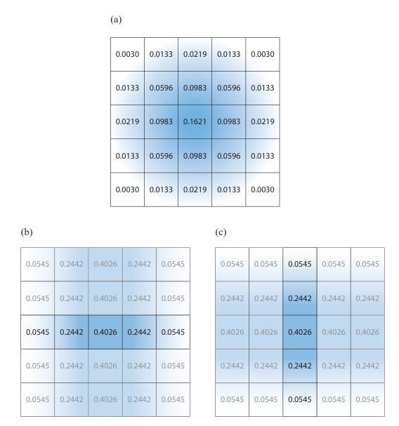
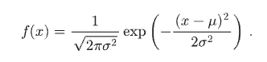

This time I had to code this manually, a crucial feature for the game aesthetics like glow & bloom for night or indoor scenes. This method is inspired from opengl tutorial modified to fit with the engine structure, and I don't use MRT (Multiple Render Target) here. Simple linear pipeline from top to bottom.

[https://learnopengl.com/Advanced-Lighting/Bloom](https://learnopengl.com/Advanced-Lighting/Bloom)

## Render Target

First I added new RT specifically for post processing purpose.
Here I used the term Collection, Resolved, Buffer, and Filtered as a way to mirror how the flow is carried out.

COLLECTION -> Draw the registered objects specific for PostProcess
COLLECTION_RESOLVED -> Convert the MSAA enabled RT to standard non multisample RT
BUFFER1/2 -> Extra non MSAA RT for certain postprocess like bloom/glow (ping pong pass)
FILTERED  -> Result from BUFFER1/2 or RESOLVED may ended up here. It's the final buffer to compose the related BUFFER. The RT write to shaders that accepts textures and add them together.

```
    enum class RenderTargetOptions {
        MAIN = 0,
        GAME = 1,
        EDITOR = 2,
        SHADOW = 4,

        POSTPROCESS_COLLECTION = 5,
        POSTPROCESS_COLLECTION_RESOLVED = 6,
        POSTPROCESS_BUFFER1 = 7,  // non msaa
        POSTPROCESS_BUFFER2 = 8,  // non msaa
        POSTPROCESS_FILTERED = 9,

        NONE
    };
```


### Camera

I need to attach this post process behavior to somewhere representative like scenes or cameras. The latter is a better and more flexible approach, multiple views rendered together with different filter is useful.

So I just add one new settings state to the camera struct

```
    struct PostProcessSettings {
        bool active = false;
        Graphics::PostProcessOptions type = PostProcessOptions::NONE;
        struct {
            float sigma = 1.3;
            int32_t radius = 4;
            int32_t blur_pass = 1;
            inline void UpdateRadius() {
                radius = std::min<int32_t>(std::ceil(sigma * 3), 8);
            };
        } bloom;
        ...
    };
    struct Camera : SceneObject {
        bool perspective = true;
        PostProcessSettings postprocess;
        ...
        }
    };

```

## Collection step

Some postprocess affects targeted objects with unique variables like emissive properties. We use this step to collect and draw those objects.If collection is not needed then simply copy main render target for fullscreen postprocess.

You can have any sort of collection logic implemented. In my case I made one batcher 

```
    if(opt == PostProcessOptions::GLOW) {
        // Collect emitters
        for(SceneObject * node : scene->drawables) {
            ...
            if(*strength > 0.0f) { .. }
        }
        ...
    }
```

## Filter Application

Once the collection step output drawing of isolated objects, we can feed it to the next RT. In this example I'll go with simple glow/bloom effect. Two approach : Box blur or Gaussian Blur. 

### Box Blur

Straight forward, for each pixel loop NxN pixels around it, sum all values then divide by sample count. The averaged result is sufficient enough but not great or smooth looking. I prefer this approach whenever I have to remember what blur is in CG.

```
float4 blur(float4 base, float2 uv) {
    float w;
    float h;
    source_rt.GetDimensions(w, h);
    float2 texel_size = 1.0 / float2(w, h);
    float3 rgb;
    float samples;
    for(int i = -SAMPLE_SIZE; i <= SAMPLE_SIZE; ++i) {
        for(int j = -SAMPLE_SIZE; j <= SAMPLE_SIZE; ++j) {
            float2 offset = float2(i,j) * texel_size;
            float3 px = source_rt.Sample(linear_clamp_sampler, uv + offset).rgb;
            rgb += px;
            samples++;
        }
    }
    float4 final = float4(rgb / samples, base.a);
    return final;
}

```

### Gaussian Blur

Not state of the art but I won't go further than this for solo dev. It's plenty good, even on par with air brush effect in painting/photo software. 

You can read the theoretical part from [wikipedia](https://en.wikipedia.org/wiki/Normal_distribution) or in RealTime Rendering book p.515

Cut to the core of the meat, in order to produce proper Gaussian Blur, we need to have two things : weights and passes. As shown in this figure each pixels will have their assigned numbers we called weight, and those will serves as multiplier for the pixel values. The further from the center the weaker the value.



Then straight to the general form of normal distribution to make generate the weights



We'll strip the constants on the left side of the form, and just keep the exp(...) part. Remember in the implementation radius defines the number of the weights, for example a radius of 4 expects weights of 9 (leftside=4, center=1, rightside=4), but if mirrored, you just need `weights[5]`, hence :

```
    inline std::vector<float> GaussianWeights(float sigma, int radius) {
        // -r ... 0 ... r
        // sum = ∑ (w[(-r...r)])
        std::vector<float> weights(radius + 1, 0.0f);
        float sum = 0;
        for(int i = 0; i <= radius; i++) {
            weights[i] = expf(-((i * i)/(2.0f * sigma * sigma)));
            sum += i==0 ? weights[i] : 2 * weights[i]; // non center weights gets twice as
        }
        for(auto &w : weights) w /= sum;
        return weights;
    }
```
Ideally radius value is derived from the sigma, so `sigma = radius / 3.0` or `radius = sigma / 3.0f`. Sigma often directly related to the smoothness and size of the blur, but with more ping-pong passes you can smear it a little bit without adding more sampling.

Draw this in ping-pong manner by sending horizontal flags to let shader know whether it should run sampling on X or Y axis. You can use any number of passes as long as its greater than 2. 

in cpp: 

```
for(uint8_t i = 0; i < passes; i++) {
    Graphics::Buffer post_process_texture = {};
    if(i % 2 == 0) {
        // Take BUFFER1, write to BUFFER2
        ...
    }
    else {
        // Take BUFFER2, write to BUFFER1
        ...
   }
} 

```

in shader:

```
float4 gaussian_blur(float4 base, float2 uv) {
    float w;
    float h;
    source_rt.GetDimensions(w, h);
    float2 texel_size = 1.0 / float2(w, h);
    float3 result;
    if(horizontal_pass) {
        for(int i = -sample_size; i <= sample_size; ++i) {
            float offset_x = i * texel_size.x;
            result.rgb += source_rt.Sample(linear_clamp_sampler, float2(uv.x + offset_x, uv.y)).rgb * weights[abs(i)];
        }
    }else{
        for(int i = -sample_size; i <= sample_size; ++i) {
            float offset_y = i * texel_size.y;
            result.rgb += source_rt.Sample(linear_clamp_sampler, float2(uv.x, uv.y + offset_y)).rgb * weights[abs(i)];
        }
    }
    return float4(result, base.a);
}

```

## Postprocess - Compose

### Result


