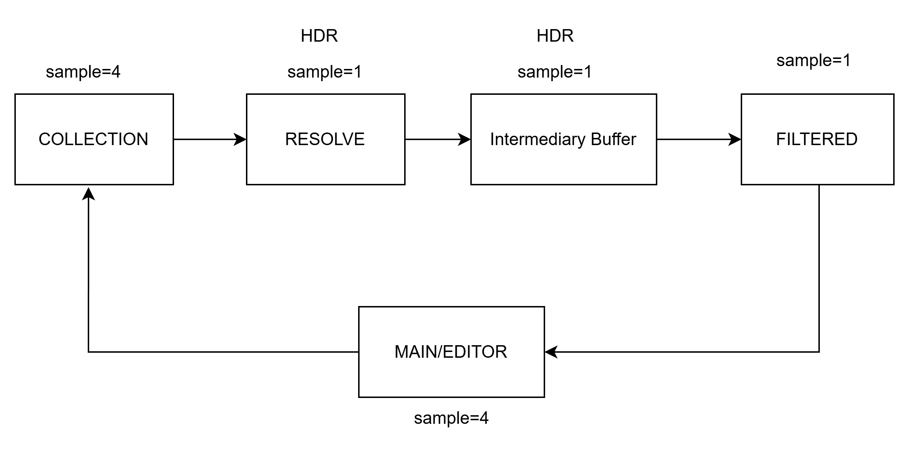
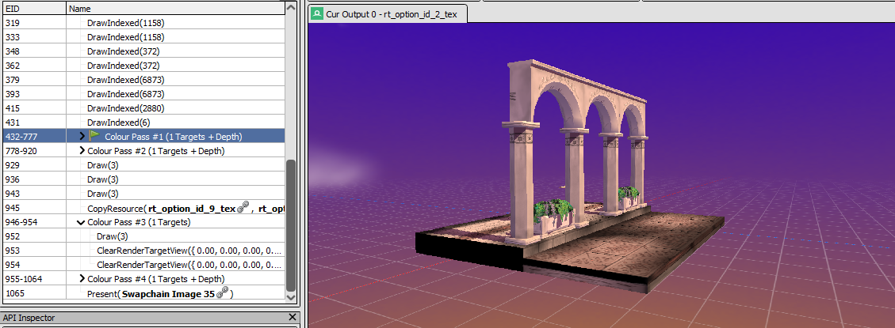
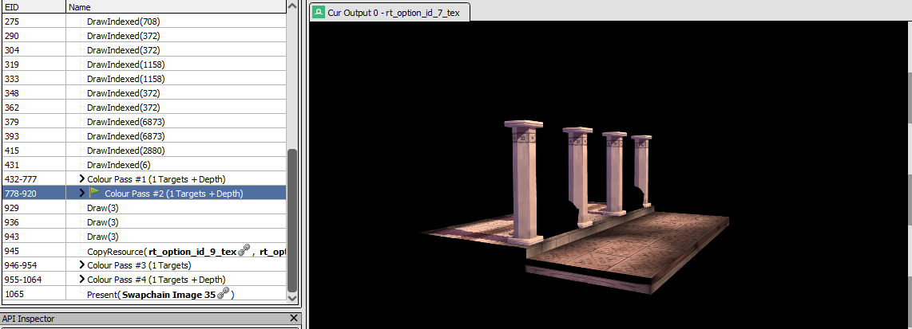
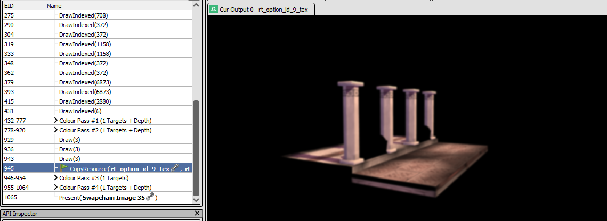
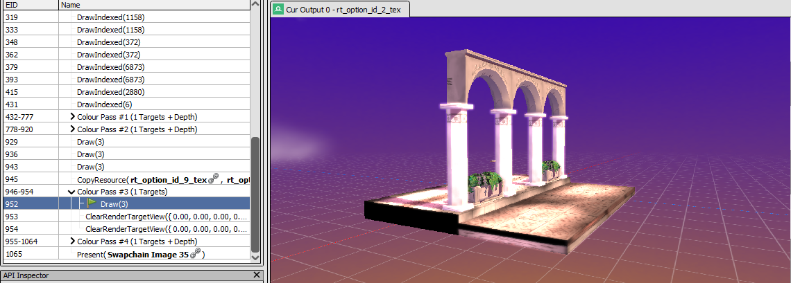

This time I had to code this manually, a crucial feature for the game aesthetics like glow & bloom for night or indoor scenes. This method is inspired from opengl tutorial modified to fit with the engine structure, and I don't use MRT (Multiple Render Target) here. Simple linear pipeline from top to bottom.

[https://learnopengl.com/Advanced-Lighting/Bloom](https://learnopengl.com/Advanced-Lighting/Bloom)

## Render Target

First I added new RT specifically for post processing purpose.
Here I used the term Collection, Resolved, Buffer, and Filtered as a way to mirror how the flow is carried out.

COLLECTION -> Draw the registered objects specific for PostProcess
COLLECTION_RESOLVED -> Convert the MSAA enabled RT to standard non multisample RT
BUFFER1/2 -> Extra non MSAA RT for certain postprocess like bloom/glow (ping pong pass)
FILTERED  -> Result from BUFFER1/2 or RESOLVED may ended up here. It's the final buffer to compose the related BUFFER. The RT write to shaders that accepts textures and add them together.

```
    enum class RenderTargetOptions {
        MAIN = 0,
        GAME = 1,
        EDITOR = 2,
        SHADOW = 4,

        POSTPROCESS_COLLECTION = 5,
        POSTPROCESS_COLLECTION_RESOLVED = 6,
        POSTPROCESS_BUFFER1 = 7,  // non msaa
        POSTPROCESS_BUFFER2 = 8,  // non msaa
        POSTPROCESS_FILTERED = 9,

        NONE
    };
```



### Camera

I need to attach this post process behavior to somewhere representative like scenes or cameras. The latter is a better and more flexible approach, multiple views rendered together with different filter is useful.

So I just add one new settings state to the camera struct

```
    struct PostProcessSettings {
        bool active = false;
        Graphics::PostProcessOptions type = PostProcessOptions::NONE;
        struct {
            float sigma = 1.3;
            int32_t radius = 4;
            int32_t blur_pass = 1;
            inline void UpdateRadius() {
                radius = std::min<int32_t>(std::ceil(sigma * 3), 8);
            };
        } bloom;
        ...
    };
    struct Camera : SceneObject {
        bool perspective = true;
        PostProcessSettings postprocess;
        ...
        }
    };

```

## Post Process - Collection step

## Postprocess - Render and Addition


### Result









