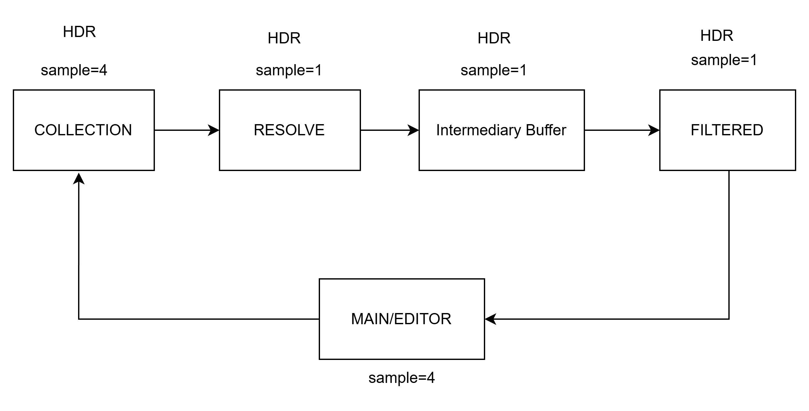

Glow and bloom are a big part of the look of night and indoor scenes this time decided that I had to code them by hand. The method is based on the LearnOpenGL bloom tutorial, adapted to my engine's structure. I don't use MRT (Multiple Render Targets). A simple linear pipeline, top to bottom, is enough.

The code is tailored to my engine. Some conventions will need translating to your own setup.

## A. Render Targets

First, I added new render targets just for post processing. The names (Collection, Resolved, Buffer, Filtered) mirror how the flow runs:

- `COLLECTION`: draws the objects registered for post processing.
- `COLLECTION_RESOLVED`: converts the MSAA render target into a regular non-multisample one.
- `BUFFER1` / `BUFFER2`: extra non-MSAA targets for effects like bloom/glow (ping-pong passes).
- `FILTERED`: holds the final filter result, whether it came from `BUFFER1/2` or `RESOLVED`. This is what gets composed onto the target.

```cpp
enum class RenderTargetOptions {
    MAIN = 0,
    GAME = 1,
    EDITOR = 2,
    SHADOW = 4,

    POSTPROCESS_COLLECTION = 5,
    POSTPROCESS_COLLECTION_RESOLVED = 6,
    POSTPROCESS_BUFFER1 = 7,  // non msaa
    POSTPROCESS_BUFFER2 = 8,  // non msaa
    POSTPROCESS_FILTERED = 9,

    NONE
};
```

Glow and bloom benefit a lot from HDR. 8 bit works, but tone mapping gets awkward and emissive strength causes abrupt value ranges. Use `DXGI_FORMAT_R16G16B16A16_FLOAT` for your SRV/RT.



## B. Camera

The post process behavior needs a home, like the scene or the camera. The camera is the better and more flexible choice, since multiple cameras can render the same scene with different filters.

Add a new settings struct to the camera:

```cpp
struct PostProcessSettings {
    bool active = false;
    Graphics::PostProcessOptions type = PostProcessOptions::NONE;
    struct {
        float sigma = 1.3f;
        int32_t radius = 4;
        int32_t blur_pass = 1;
        inline void UpdateRadius() {
            radius = std::min<int32_t>(std::ceil(sigma * 3), 8);
        };
    } bloom;
    ...
};

struct Camera : SceneObject {
    bool perspective = true;
    PostProcessSettings postprocess;
    ...
};
```

## C. Collection Step

Some effects only affect specific objects, using their own variables like emissive strength. This step collects and draws those objects. For fullscreen effects, it just copies the main render target.

You can write any collection logic you want. For glow, we filter out everything that isn't an emitter so it doesn't get caught in the blur.

```cpp
if(opt == PostProcessOptions::GLOW) {
    // Collect emitters
    for(SceneObject * node : scene->drawables) {
        ...
        if(*strength > 0.0f) { .. }
    }
    ...
}
```

## D. Filter Application

The collection step gives us a render of only the isolated objects. Next, we feed it into the filter. For a simple glow/bloom there are two options: box blur or Gaussian blur.

### a. Box Blur

Straightforward. For each pixel, loop over the NxN pixels around it, add up the values, and divide by the sample count. The result is good enough but not very smooth. It's the one I can always remember when I forget how blur works.

```hlsl
float4 blur(float4 base, float2 uv) {
    float w;
    float h;
    source_rt.GetDimensions(w, h);
    float2 texel_size = 1.0 / float2(w, h);
    float3 rgb = 0;
    float samples = 0;
    for(int i = -SAMPLE_SIZE; i <= SAMPLE_SIZE; ++i) {
        for(int j = -SAMPLE_SIZE; j <= SAMPLE_SIZE; ++j) {
            float2 offset = float2(i, j) * texel_size;
            float3 px = source_rt.Sample(linear_clamp_sampler, uv + offset).rgb;
            rgb += px;
            samples++;
        }
    }
    float4 final = float4(rgb / samples, base.a);
    return final;
}
```

### b. Gaussian Blur

Not state of the art, but it's as far as I'll go as a solo dev. It's plenty good, and comparable to the airbrush effect in painting and photo software.

For the theory, see [Normal distribution (Wikipedia)](https://en.wikipedia.org/wiki/Normal_distribution) or *Real-Time Rendering* (see References), p. 515.

A proper Gaussian blur needs two things: **weights** and **passes**. As the figure shows, each pixel gets a weight that multiplies its value. The further from the center, the smaller the weight.


Weights come from the general form of the normal distribution:


We drop the constant on the left and keep only the `exp(...)` part. The radius sets how many weights we need. For example, a radius of 4 means 9 weights (4 left, 1 center, 4 right). Since the weights are mirrored, we only store 5, hence `weights[5]`:

```cpp
inline std::vector<float> GaussianWeights(float sigma, int radius) {
    // -r ... 0 ... r
    // sum = ∑ (w[(-r...r)])
    std::vector<float> weights(radius + 1, 0.0f);
    float sum = 0;
    for(int i = 0; i <= radius; i++) {
        weights[i] = expf(-((i * i) / (2.0f * sigma * sigma)));
        sum += i == 0 ? weights[i] : 2 * weights[i]; // non-center weights count twice
    }
    for(auto &w : weights) w /= sum;
    return weights;
}
```

Ideally the radius is derived from sigma: `radius = sigma * 3.0f`, or `sigma = radius / 3.0f`. Sigma controls the smoothness and size of the blur. More ping-pong passes also spread the blur wider without adding more samples.

Draw in ping-pong order, and send a horizontal flag to the shader so it knows whether to sample along X or Y. Use at least 2 passes, and keep the count even so the last pass is vertical.

In C++:

```cpp
for(uint8_t i = 0; i < passes; i++) {
    Graphics::Buffer post_process_texture = {};
    if(i % 2 == 0) {
        // Read BUFFER1, write to BUFFER2
        ...
    }
    else {
        // Read BUFFER2, write to BUFFER1
        ...
    }
}
```

In the shader:

```hlsl
float4 gaussian_blur(float4 base, float2 uv) {
    float w;
    float h;
    source_rt.GetDimensions(w, h);
    float2 texel_size = 1.0 / float2(w, h);
    float3 result = 0;
    if(horizontal_pass) {
        for(int i = -sample_size; i <= sample_size; ++i) {
            float offset_x = i * texel_size.x;
            result += source_rt.Sample(linear_clamp_sampler, float2(uv.x + offset_x, uv.y)).rgb * weights[abs(i)];
        }
    } else {
        for(int i = -sample_size; i <= sample_size; ++i) {
            float offset_y = i * texel_size.y;
            result += source_rt.Sample(linear_clamp_sampler, float2(uv.x, uv.y + offset_y)).rgb * weights[abs(i)];
        }
    }
    return float4(result, base.a);
}
```

## E. Compose

The last step combines the filter result (`POSTPROCESS_FILTERED`) with the main target, or wherever you want the final image. For glow/bloom I use additive blending so it looks translucent.

```cpp
Graphics::UseBlendState(BlendingModeOptions::ADDITIVE);
FullscreenPass(
    GetShaderByName("post_process_compose"),
    RenderTargetOptions::POSTPROCESS_FILTERED,
    target_rt);
```

The shader just passes each pixel through:

```hlsl
PS_OUTPUT PS_MAIN(VS_OUTPUT p_in) {
    PS_OUTPUT p_out;
    float2 uv = p_in.uv;
    float4 source_color = source_rt.Sample(point_clamp_sampler, uv);
    p_out.color = source_color;
    return p_out;
}
```

## Result

Here's the whole flow in RenderDoc. Each pass feeds the next.

1. Draw Pass


2. Collection Pass


3. Filter Pass


4. Compose Pass


This isn't meant as a tutorial. I just wanted to show my simple, layman's approach to graphics programming. As long as it works and runs fast, we don't need the textbook way.

## References

- de Vries, Joey. "Bloom." *LearnOpenGL*. [https://learnopengl.com/Advanced-Lighting/Bloom](https://learnopengl.com/Advanced-Lighting/Bloom)
- Akenine-Möller, T., Haines, E., Hoffman, N. *Real-Time Rendering*, 3rd ed. A K Peters, 2008.

