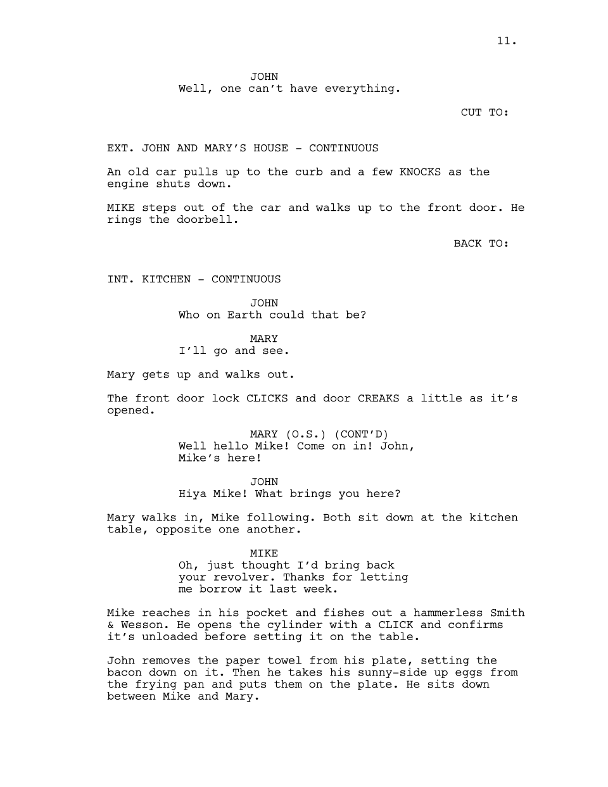
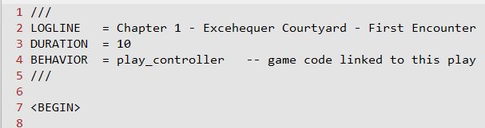
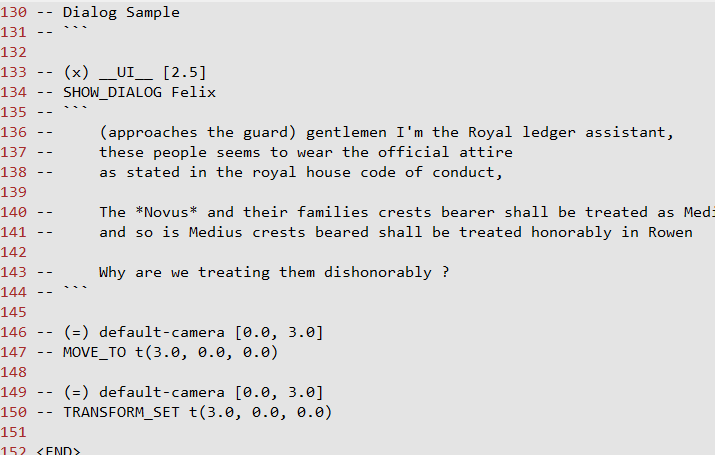
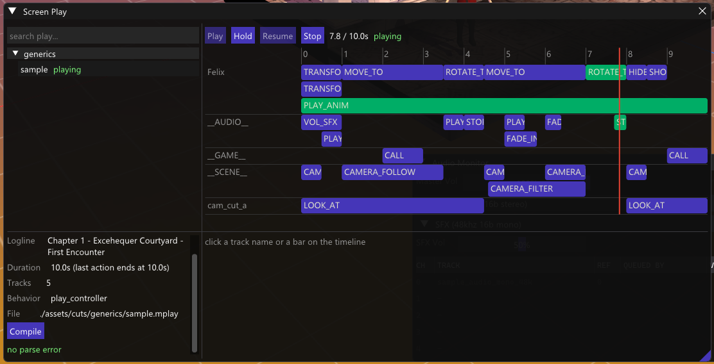

Quick update, The engine is reaching almost its completion, and this week I'm tweaking the some new commands for my custom data format for storing screenplay sequence (aka. cutscene). Along the way refactoring many parts of the Audio Systems.  

## DSL new Grammar and Actions

### A. Brief History

The engine uses it's specific language to construct cutscenes, composed of track and keys. I called the entire cutscene system as **Play** as in drama play. The reason is how practical is screenplay formats not only in making films but also game cutscenes. I like how the screenplay uses strict keywords like FADE, EXT, CUT etc to describe events, even if it's not as strict as a programming language, this is a good start to systemize a theatrical events, and I show you how this format is good enough to serve as ground for game cutscene textual source.



First straight to the data structure form so that everyone can see the simple way onstruct a moving film:

```
struct Play {
  ...
  std::unordered_map<std::string, Track> tracks;
  ...
}

struct Key {
  float ta;
  float tb;
  float t;
  std::string command;
  ...
}

```

Inspired from the screenplay format, The grammar for the our script starts with header defintion explaining the description of act, duration budget and behavior link (DLL functions call to interact with game world). Then proceeded with the content within <BEGIN> and <END> markup style enclosure.



Then each action are grouped in **Action** blocks, these blocks consist of *action definition* and *action command.*  
The syntax started with sigil (x) an (=) respectively tells the **Play** to treat this as parallel or blocking key, then the actor name with it's time range (some action will use this as `lerp` value).  
New line, then you define the reserved command names.  
Everytime you add new blocks, the **Play** will collect and group it based on the actors. 

The general **Action** block Form (Exception exist) :  

```
<sigil> <game_actor/system_actor> [ta, tb]  -- action definition
<command> <target> <args>                   -- action command
```



### B. The Commands Improvement

At first the commands I made were just TRANSFORM_SET, PLAY_BGM and PLAY_ANIM. Then expanded to all sorts of useful utility such as `MOVE_TO, ROTATE_TO, LOOK_AT, CAMERA_FOLLOW, CAMERA_SET, CAMERA_FILTER, PLAY_BGM/SFX, STOP_SFX/BGM, VOL_SFX/BGM, VOL_MASTER, SHOW/HIDE.`  
Same Principle with the other commands with extra treatment.

## Visualizing Play on Editor

Once script gets big, debugging will surely become a iteration bottleneck, so I decided to make one simple read-only sequence visualizer. The goal is to be able check for parsing errors, then whether the keys are shaped and positioned at the correct lane. 

The UI divided into four region, top left for list asset on disk, top right for the main timeline view, the bottom part are just extra info details. It didn't let you to move things out, because it will intervene with the play text, thus special handling needed. We're avoding complexity of such low ROI.

Note I let AI implement this window from my basic sketches, the pattern is already all over the codebase, It's a waste of time if I were to write this on my own. Especially the timeline part, very tricky and dense with imgui drawlist logic.



## What's Next

That's it for this week. There are only two task left in my back log before pre production phase, Collision System and In-Game Console.